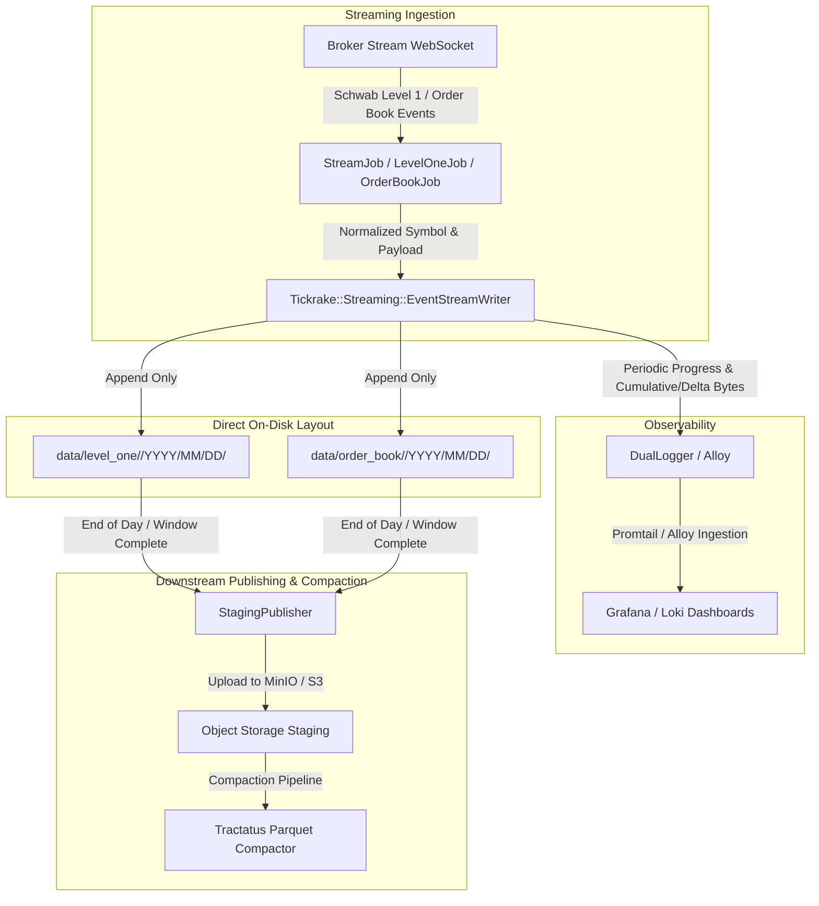

# Event Ingestion & Streaming Storage Architecture

## Overview & Background

Previously, streaming collectors in Tickrake (Level 1 quotes and Order Book depth) wrote incoming events to short-lived chunk files in a staging buffer directory:
```
~/.tickrake/staging/pending_events/<job_name>_<timestamp>.ndjson.tmp -> .ndjson
```

These files were rotated continuously based on interval timers (`rotation_interval_seconds`) and size limits (`rotation_size_bytes`). Multiple symbols were mixed together in each rotated chunk file.

This required complex downstream processing to unpack mixed-symbol chunks, reconcile rotation artifacts, and recover stranded `.tmp` files.

## Target Design: Direct-to-Folder Append

Streaming events are now written directly to daily, per-symbol append-only NDJSON files under the primary data directory:
- **Level 1**: `data/level_one/<provider>/<YYYY>/<MM>/<DD>/<symbol>.ndjson`
- **Order Book**: `data/order_book/<provider>/<YYYY>/<MM>/<DD>/<symbol>.ndjson`

Intermediate chunking and the `pending_events` directory have been eliminated.



## Key Design Decisions

### 1. Daily Per-Symbol Append Over Rotating Chunks
- **Elimination of Intermediate Staging Buffer**: Writing straight to `data/<dataset>/<provider>/<YYYY>/<MM>/<DD>/<symbol>.ndjson` matches the storage layout expected by `StagingPublisher` and downstream tools (such as Tractatus), eliminating intermediate buffer staging.
- **Append-Only Mode**: Files are opened in `"a"` mode. As quotes and depth arrive, lines are formatted as single-line JSON and flushed immediately (`file.flush`), guaranteeing data durability while avoiding open/close thrashing.
- **Midnight Date Rollover**: `EventStreamWriter` inspects the event's UTC date. When the date rolls over, existing open file handles for previous dates are closed and new files for the next day are opened automatically.

### 2. Symbol Normalization at the Storage Boundary
- Futures contracts often contain slashes (e.g. `/ES`, `/NQ`), which collide with filesystem directory separators.
- Configured provider definitions specify `symbol_map` normalizations (e.g., `/ES` -> `^ES`, `/NQ` -> `^NQ`).
- `EventStreamWriter` routes paths through `Tickrake::Storage::Paths`, ensuring normalized filesystem tokens (`^ES.ndjson`) while preserving original event payloads.

### 3. Removal of Rotation Configuration & DSL Directives
- `rotation_interval_seconds` and `rotation_size_bytes` were removed from `LevelOneConfig`, `OrderBookConfig`, and their respective DSL builders (`LevelOneBuilder`, `OrderBookBuilder`, `StreamBuilder`).
- Rather than leaving backward-compatibility no-ops, obsolete rotation options were removed to keep configuration and DSL clean and explicit.

### 4. Intraday Observability & Byte Metrics
- Operations require visibility into raw market data ingest volume throughout the day, prior to end-of-day staging publishing or Parquet compaction.
- `EventStreamWriter` maintains running counters per symbol and date:
  - `byte_count`: Cumulative raw bytes written to the file for the current day/session.
  - `delta_bytes`: Incremental raw bytes appended since the last progress log.
  - `event_count` / `delta_events`: Number of events processed.
- Periodic watchdog loops in `StreamJob`, `LevelOneJob`, and `OrderBookJob` flush progress every 30 seconds (and upon graceful shutdown) emitting structured `stream_bytes_written` logs.
- DualLogger emits these as JSON lines to `~/.tickrake/logs/*.jsonl`, which Grafana Alloy streams into Loki for real-time dashboard aggregation and volume tracking.

### 5. Safe Migration for Legacy Pending Files
- A standalone migration script (`scripts/migrate_pending_events.rb`) was created to parse legacy files in `~/.tickrake/staging/pending_events/` and route records into their target `data/` destination.
- **Safety Rules**:
  - Excludes active `.tmp` files.
  - Excludes any files modified on or after the run date (`--before DATE` defaults to today) to avoid conflicting with active collectors.
  - Defaults to **not** deleting source files (`delete_migrated: false`), requiring an explicit `--delete` flag to prune source files after migration.
